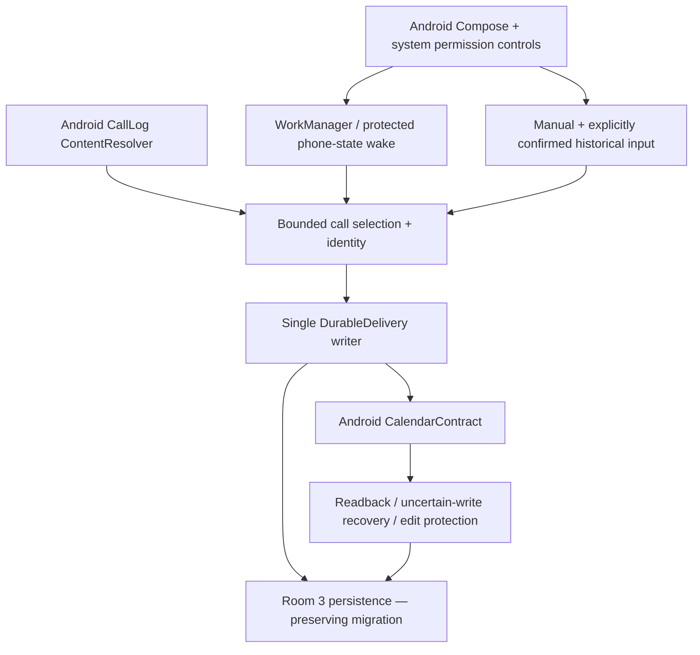

# Active architecture — Android 17 only

**Decision (2026-11-24):** This document supersedes the *implementation order* in [the historical future architecture](future-architecture.md); historical evidence and previous authorisations remain audit records, not live work queues. [Active scope](active-scope.json) is the machine-readable scope. [Track registry](tracks.md) names active and deferred owners.

## Ponytail decision: native instead of multiplatform

One deployable **Android 17 (API 37)** application. Kotlin + native **Jetpack Compose**, standard Android permission/results/lifecycle patterns and system widgets where feasible. Each Activity uses one lifecycle-bound Compose root. The standard controls replaced the custom buttons, hybrid layouts, and legacy View dependencies after [rendered and accessibility qualification](tracks/compose_app_20261021/implementation-evidence.md#android-17-native-screen-roots-and-durable-delivery). Avoid DI, custom routers, custom preference/state frameworks and new cross-platform scaffolding without a second proved consumer.

Room owns both existing database files. The preserving migrations retain their filenames, historical rows, source namespaces and atomic receipt ordering. **Never** invoke `fallbackToDestructiveMigration`, clear app data to retry, or replay an unknown calendar insertion.

## Runtime and dependency choices

- Android `CallLog.Calls` and `CalendarContract` are the correct API boundary. No direct cloud connector unless a proved native-provider gap exists. The app does not need `INTERNET` permission for the first release.
- WorkManager is the single durable scheduler. Keep generation checks, cancellation and explicit user activation.
- **Room 3.0.3** uses KSP, AndroidSQLiteDriver and suspend DAOs. Receipt, checkpoint and import transactions use Room’s native writer connection. Recovery persists intent before touching the calendar. [Track 22](tracks/room3_android17_20261124/plan.md).
- Material 3 provides the standard buttons, checkboxes, and date fields. Activities own the platform permission, confirmation, and provider effects, and Compose nodes expose stable accessibility labels.
- No Rust, Kotlin Multiplatform production module, cross-platform UI, Swift app or second writer in active builds.

## Test and build execution order

1. **Local macOS Android 17 emulator first**: a dedicated fresh `calltrack-android17-local` AVD, Android 17 / API 37 with a qualified host-ABI system image (for hosted Linux: `system-images;android-37.2;google_apis_ps16k;x86_64`, revision 7), and `scripts/qualify_android17_local.sh SERIAL`. Selection is explicit and rejects physical devices and other AVDs. Native UI/provider/recovery suites own their synthetic cleanup; do not reset unrelated devices.
2. Host-only pre-commit and Python/Kotlin/JVM checks before committing. Source-bound app/test APK build and lint before touching a guest.
3. Hosted Linux Android 17 KVM emulator is the independent fallback/check; remove API 26/33/36 from *active* job matrices. Historical receipts and test sources are preserved but do not claim current API 37 acceptance.
4. **Official GitHub self-hosted runner** on a qualified local Apple Silicon Mac, registered with dedicated `calltrack-android17` label, runs the native macOS host's Android emulator directly. Its workflow is manually dispatched on protected `main` only; runner availability, Xcode/toolchain, trusted source and cleanup must be explicitly confirmed. No such local runner was connected or verified by this review.
5. **Apple `container`** on macOS 26+ is a Linux-container facility. It can optionally run isolated Linux-only build/static/security tools on Apple Silicon, but cannot provide macOS binaries, Xcode, EventKit or a macOS-native Android emulator inside the Linux container. Prefer no container over an unqualified nested-virtualisation stack; a container is not a substitute for the official self-hosted runner process on macOS.

## Release, security and privacy boundary

Keep signed release candidacy, licence/source conveyance, real call and account calendar readback, permission revocation, surviving upgrade, unknown write recovery and human-edited event protection separate from emulator smoke tests. Google Play `READ_CALL_LOG` eligibility is a product/distribution blocker requiring verification; do not promise store distribution. Min SDK 37 is an intentional **new product support boundary**, not permission to destroy or discard existing development user data. Existing historical migration fixtures remain mandatory even though older OS devices are no longer supported.

## Evidence and documentation: one writer, many pointers

| What | Canonical source | Other documents should do |
|---|---|---|
| Runtime platform | `app/build.gradle` | Link, do not copy current versions |
| Python interpreter | `.python-version` | Link, do not hardcode historical patch |
| Dependency pins/trust | Gradle files / `gradle/verification-metadata.xml` | Link to exact graph + SHA |
| Current work scope | `conductor/active-scope.json` and `conductor/tracks.md` | Link to the owner track |
| Executable evidence | Source-bound test logs/receipts in ignored `.local/` and GitHub Actions artifacts | Record source SHA, run URL, checksum and one-line disposition |
| Historical immutable evidence | `conductor/archive/` and prior track evidence | Do not regenerate or copy |
| Issues and delivery | GitHub issue/PR | Cross-reference the Conductor track, do not maintain a second backlog |

Use a concise checkpoint per accepted release or major transition: source/artefact SHA, command, environment (API and ABI), exact test result, failures/limitations, evidence URL. **Do not duplicate raw logs or megabyte JSON receipts in Conductor** when a source-bound retained artifact exists. Existing tracked historical evidence must remain available. Promote native/Room work only when verified; until then report unqualified truthfully.

## Explicit deferrals

Android API 26/33/36 and all other OS/runtime targets, macOS, iOS, desktop and cross-platform UI, KMP production reuse, Rust and direct Graph/Google/CalDAV connectors are on the [historical roadmap](roadmap.md), **not** in active product development. Reopen only after an Android 17 production acceptance and a concrete requirement, with a new decision and exact regression evidence.

## GitHub execution links

[Native architecture and scope PR #114](https://github.com/edithatogo/CallTrack/pull/114) · [Room migration issue #115](https://github.com/edithatogo/CallTrack/issues/115) · [native UI cleanup issue #116](https://github.com/edithatogo/CallTrack/issues/116) · [local Apple Silicon runner issue #117](https://github.com/edithatogo/CallTrack/issues/117). These are task pointers only; an open issue or draft PR does not establish acceptance.

## Required checks on GitHub main

Strict branch protection requires native build qualification, hosted Android 17 UI acceptance, workflow lint, secret history scanning, privacy and secrets, call-data fuzzing, and both the CodeQL summary and each configured analysis. The hosted API 37 workflow runs on every pull request and verifies settings, imports, full process recovery, accessibility, and fixture cleanup.

Build qualification runs on pull requests, pushes to main, tag pushes, and
manual dispatch. A feature-branch push leaves qualification to its pull
request. The hosted UI runner boots its fresh emulator while Gradle builds
the source-bound APKs. It verifies Android and AVD identity before running
the complete rendered suites and fixture cleanup.

The [CodeQL ruleset](https://github.com/edithatogo/CallTrack/rules/27936995) requires scan results and blocks new alerts at every severity.
